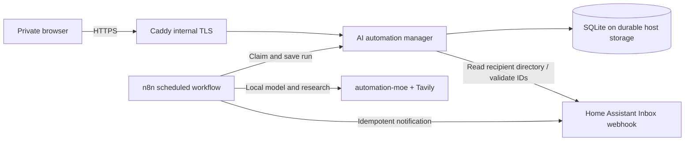

# AI automation manager — parallel replacement

**State:** implementation candidate, not deployed. The current Notion database
and `Notion AI automations` workflow remain active and unchanged.

Issue: [HomeCompute #134](https://github.com/madslundt/HomeCompute/issues/134)

## Goal

Create a self-hosted site where Mads can create, edit, remove, and review
recurring automations. n8n remains the schedule and execution engine; Home
Assistant Inbox remains the delivery channel and source for recipient choices.
The new application has its own SQLite store and must not read or mutate the
existing Notion database. It supports a later, deliberate transition.

## Operating profiles

The model supports the three requested use cases without separate hardcoded
products:

| Example | Suggested settings |
| --- | --- |
| Ongoing topic | Changes since last run; resolve at success criteria or manually archive; choose daily or hourly only when needed |
| Short-term follow-up | Fresh briefing or changes; explicit success criteria; resolve after verified completion |
| Daily news | Fresh briefing; morning/evening slot; send every run or only if notable changes |
| System monitoring | Current-status check; hourly or selected time slot; notify only when action is needed |

The task description specifies scope and reading level. Run summaries use
headings, concise prose, bullets, clear status and dates, and source links when
research is involved.

## Architecture

Site and n8n communicate on the isolated automation Docker bridge. The manager
has a fixed address and an explicit egress rule for only Home Assistant port 80.
It receives no wildcard host port; Caddy publishes the private HTTPS route. The
existing `/run/secrets/automation/inbox-webhook-env` credential remains external
to Git. Site login secrets and a distinct workflow bearer token are also external.

## Data and reliability

- The site stores all editable fields, HA recipient IDs, timestamps, and run
  history. It returns only minimal user names/IDs from Home Assistant.
- Status values remain Draft, Ready, Resolved, and Archived. Only Ready items
  are scheduled. Manual archive is available regardless of success criteria.
- 07:00/21:00 local slots remain compatible with current behavior. Hourly runs
  happen at minute 00, only on selected weekdays. Hour keys include the offset
  to handle DST fall-back.
- The workflow stores the complete replacement context and a concise summary.
  Delivery uses the run UUID as the Home Assistant Inbox `external_id`. Pending
  delivery retries do not repeat research.
- Notification choices suppress delivery after the run when the output has no
  changes or no action needed. The run and updated context still remain visible
  in the site.
- No seed records or Notion export are included. Synthetic records are used for
  acceptance only.

## Rollout boundary

The new Compose service is opt-in and the deployment template keeps it disabled
by default. The current Notion setup must remain active until the site, schedule
workflow, Inbox recipient picker, backup/restore, and notification presentation
have been reviewed with synthetic records and accepted. Migration and cutover
require a separate explicit plan.

See the [application and operations guide](../automations/ai-automation-manager/README.md)
for field definitions and setup details.
