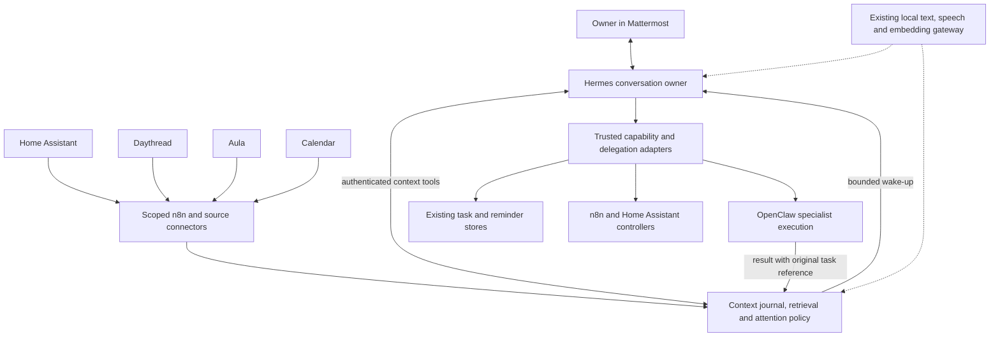

# A proactive personal assistant across HomeCompute

Date: 2026-11-06. Status: first source implementation staged for review,
uncommitted and undeployed. No live service, permission, model, workflow or
schedule was changed. The complete plan remains phased as described below.

Owner priorities: Home Assistant, Daythread, Aula and Calendar first; add other
services later. Target substantial autonomy, including tested improvements to
workflows, with intervention required only outside an established policy.

Implementation handoff: [issue 61](https://github.com/madslundt/HomeCompute/issues/61)
now has an opt-in source candidate on `codex/proactive-assistant`, with a scoped
context API, four adapters, shadow attention, owner Hermes tools, feedback
candidates, guarded bridge activation and explicit bounded delivery. The
authenticated Daythread provider is a separate source change on
`codex/assistant-context-export`. See the [service runbook](../deploy/assistant-context/README.md).
Neither branch is deployed. These implementations do not establish automatic
cross-source reasoning, native Hermes-to-OpenClaw handoff, hybrid journal search,
scheduled briefing consolidation or autonomous Git/deployment promotion. Those
remain later slices and qualification work. Daythread's partial snapshot also
does not provide a deletion feed; resolve its retention/deletion lifecycle before
claiming complete source synchronization or enabling household data.

Source validation passed: 78 tests across the seven new HomeCompute suites,
23 Daythread export/profile tests, provider Ruff checks, both worktrees'
whitespace checks, and the complete HomeCompute repository validator including
containerized Nix flake evaluation and the enabled context-service configuration.
Existing environment-dependent skips remain skips, including the uncached
pinned LiteLLM integration image. This is synthetic source evidence, not actual
Mattermost delivery, private-source readiness, mixed-load or restore acceptance.

## Recommendation

Use the existing owner-only Hermes Mattermost conversation as the proposed
front door. Keep OpenClaw's specialists and trusted HomeCompute tools, n8n's
integrations and schedules, Daythread's recordings and summaries, and Home
Assistant's action authority. Add a small, framework-independent context layer
to connect their information, remember decisions and manage attention.

Choose Hermes provisionally because it is already running for the owner and
provides a useful conversation/skill loop. Qualify the complete experience
before switching notification ownership. Hermes is not automatically more
reliable than Atlas, and OMH installation does not establish learning quality.
If Hermes fails the conversational acceptance tests, use Atlas against the
same context interface. Personal context and workflow state must survive that
choice.

The existing [Atlas plan](openclaw-grok-bot-plan.md) remains the specialist
execution workstream. This proposal changes the proposed user-facing owner;
it does not silently supersede that plan or accepted ADRs. Record the selected
entry point and standing authority in an architecture issue and ADR before
implementing a new service or changing trust boundaries.

## Evidence and remaining unknowns

The workstation checkout is at `b0e8b106dd79e30d765ddd38970c29649ebfb37b`,
155 commits behind fetched `origin/master` at
`0774a4a72f15cf9f162a7999720ce555ea42c627`. Existing local planning edits were
preserved. Source review used the newer published revision; local historical
paragraphs saying Hermes is retired or speech is still deferred are not the
current baseline. No fresh live inspection was performed for this task.

| Area | Evidence reviewed | Consequence for implementation |
| --- | --- | --- |
| Hermes | [November 6 runtime evidence][hermes-runtime] records 0.23.0, owner Mattermost/browser/boot checks and local `automation-moe` | Reuse the selected instance; measure the new proactive path separately |
| Household tools | [November 6 MCP evidence][hermes-mcp] records 50 discovered tools and seven actual read-only service checks across restart | Home Assistant metadata, Aula, calendars and owner tasks already have an integration foundation; writes are separately unverified |
| OMH | [Pinned manifest][omh-config] and [source audit][omh-audit] select 4.0.6, local routing, concurrency one, memory off and dreaming off | Preserve those settings; Mattermost private-memory identity needs separate qualification |
| Atlas tasks | [November 4 task evidence][atlas-tasks] records native English/Danish handoffs and private reminder delivery configuration | Preserve existing stores, task ownership and fixed destination enforcement |
| Retrieval | [Existing retrieval implementation][retrieval] and [automation guide][automations] provide scoped hybrid retrieval and workflow archives | Extend source coverage and permissions before adding a new vector database |
| Daythread | User reports recording and day/week summarization; published source documents its [separately owned application][daythread-owner] | Summary export, auth, ownership, revision, deletion and callback APIs still need inspection in Daythread's repository |
| Operations | Published receipts retain host revision differences and backup/recovery qualifications | Re-establish current applied state and recovery before production expansion; these are dated findings |

The [upstream capability check](research/proactive-assistant-capability-check-2026-11-06.md)
separates official framework features from installed-path acceptance. The
attached agent discussion supplies design ideas, rather than deployment evidence.

## The daily experience

One private conversation should support requests such as:

- "What needs my attention today?" — combine fresh home context, Daythread
  follow-ups, Aula changes, Calendar and existing tasks, with links to sources.
- "What did I promise yesterday?" — retrieve explicit commitments and distinguish
  a suggested action from an action the owner actually accepted.
- "Remind me when I leave" — use the existing location/reminder lifecycle and
  confirm its recorded delivery state.
- "Why did you notify me?" — explain the source change, relevance and policy.
- "Handle this automatically next time" — propose a precise reusable rule,
  show its scope and activate it through the appropriate policy lifecycle.
- "Stop", "snooze until tomorrow" and "forget this" — operate on the referenced
  watch, task or memory without losing its authoritative identity.

For example: Aula reports an early closure. The assistant compares the actual
date and selected family calendar, notices an unresolved pickup task mentioned
in Daythread, and checks relevant permitted HA presence context. It sends one
message explaining the conflict and prepares a reminder or calendar proposal.
Presence is a hint, not proof that somebody can collect a child. Under a later
approved policy it can create an owner-calendar hold and a private reminder,
then report what it actually changed. It never invents an arrangement with
another person.

## Responsibilities and source of truth

| Component | Owns |
| --- | --- |
| Mattermost + Hermes | Conversation, explanations, bounded planning and one proactive conversational identity |
| Thin context layer | Normalized event journal, source references, reviewed personal context, attention decisions, feedback and delivery coordination |
| Daythread | Original recordings, transcripts, summary versions and their deletion/retention |
| Calendar/Aula/HA | Actual calendar records, school source material and authoritative home state respectively |
| Existing task stores | Private/shared tasks, reminders, revisions, cancellation and delivery receipts |
| OpenClaw/native jobs or coding broker | Their own execution lifecycle; context stores references and projections |
| n8n or the existing timer | Exactly one schedule owner for each routine or reminder |
| Home Assistant/action controllers | Validation, authorization and execution of device changes |

The context layer coordinates rather than replacing these ledgers. A reminder
is not an execution job, an event is not a verified fact, and successful webhook
admission is not completed work. Reconcile status using the owning system.

Keep orchestration and durable state on home-core under its application
boundary; inference remains on Spark. Default to the existing Python adapter
and scoped SQLite/retrieval patterns for the first thin service. Choose its
exact boundary in the architecture issue. A separate service identity and
state directory are required; agents get no database files or general SQL.
PostgreSQL is a later option if measured concurrent writers or recovery needs
justify it. A new Redis queue, pgvector deployment or .NET service is not a
prerequisite. Use a transactional journal/outbox for durable work admission.

## Four initial integrations

| Source | First release | Follow-on autonomy |
| --- | --- | --- |
| Home Assistant | Existing scoped read tools; selected meaningful changes and freshness, not a stream of every sensor update | Narrow device policies with entity allowlists, state constraints and controller approval semantics |
| Daythread | Summary-ready/updated/deleted events; bounded excerpts, source links and candidate commitments | Reviewed commitments become existing owner tasks and bounded follow-ups |
| Aula | Existing discovery, weekly letters, posts and calendars; source IDs, coverage and changed deadlines | Link closure/equipment/permission deadlines to tasks and selected calendars |
| Calendar | Existing allowed calendar discovery/read; changes, conflicts and preparation windows | Create/update owner-calendar records within standing scope; invitations and shared changes use separate authority |

Reuse the existing trusted bridge and distinct `hermes-owner` credential. Add
only finite source-owned grants. Do not give Hermes OpenClaw's token, Daythread
database access or blanket HA access. Implement new Daythread API/export code in
Daythread's owning repository; keep HomeCompute's connector, deployment and
non-secret policy here. Do not assume a summary webhook currently exists.

An initial bounded catch-up reads recent authorized history plus upcoming
calendar entries. Do not import every recording or all home history. First
surface existing school/calendar information; add newly implemented connectors
in the owner's stated order, Home Assistant → Daythread → Aula → Calendar.

## Event, memory and execution contracts

Each connector authenticates independently. The server derives allowed
principal/domain from that credential; neither the model nor event payload
can select a broader identity. Follow the existing
[personal-data contract](personal-data-and-memory.md) and
[ADR-015](adr/015-personal-data-domains-and-memory.md).

Event envelopes need a schema version, source object ID and revision, event
type, event/ingestion times, authorized scope, visibility, source reference,
bounded normalized content, retention, and correlation key. Deduplicate by
source, object, revision and event type within scope. Record update/delete
events, tolerate late arrival and reject stale revisions as current state.
Provider cursors and reconciliation scans recover missed callbacks.

Use durable processing states with leases, bounded retries and a held-failure
queue. Persist an event and its pending processing record atomically. The
same applies to a decision and its pending dispatch. A stable occurrence key
binds task creation or message delivery to the original decision. For uncertain
external effects, reconcile the provider result before retrying; do not promise
universal exactly-once delivery.

Memory has three views: source-linked history, reviewed facts/preferences, and
current tasks/questions. Reuse hybrid lexical/semantic retrieval, preserving
exact dates and source IDs. Filter scope before retrieval, and recheck source
authorization before returning results. Embeddings are retrieval aids rather
than authority. Preserve model/revision metadata for reindexing.

Explicit allowed preferences can be remembered immediately. Inferred ordinary
preferences remain candidates for review; sensitive inferences follow the
existing explicit-confirmation rule. The owner can inspect, correct, expire,
delete and export context. Propagate source deletion through summaries,
embeddings, caches and framework-local copies; retain tombstones through
restore before serving retrieval. Work recordings remain excluded without the
existing work-domain admission and separate principal.

Expose finite tools such as context search, today's context, source inspection,
memory review/correction/deletion and feedback. Existing task tools retain task
writes. A later OpenClaw handoff adapter carries actor, domain, originating
thread, stable request ID, accepted native task ID, budgets, expiry and result
references. Track actual terminal results and cancellation. Qualify this bridge
before promising that Hermes can delegate to existing OpenClaw agents.

## Two-way communication and attention

Proactive context must be available in the conversation that receives the
message. Qualify Hermes's pinned webhook/session-mirroring path, with a distinct
credential, fixed owner destination and bounded tools; otherwise implement a
minimal delivery-to-session adapter. Mirroring is best-effort and may skip a
conversation without an existing session. Persist delivery context independently,
including Mattermost post/root IDs against the decision. A reply such as "do
that" resolves to that decision and its current revision. It cannot authorize
an unrelated pending action. Mirrored source text remains untrusted evidence.

Start with natural-language replies and links to existing authenticated action
pages. Mattermost supports interactive messages, but callback identity, replay,
expiry and installed-version compatibility require qualification. Buttons may
provide snooze, dismiss, show-source and draft controls. Preserve the existing
controller's private-page approval flow for actions that require it; a chat
button must not bypass that authority.

Run deterministic filtering before Qwen. Evaluate changed deadlines, selected
home incidents, pending commitments and source-linked correlations. Qwen may
propose structured relevance and action; code enforces delivery, tool and
autonomy policy. Untrusted transcripts or school content cannot grant tools or
change policy.

Use four outcomes: retain only, next digest, prepare work, or notify now.
Suggested initial defaults are 22:00–07:00 Europe/Copenhagen quiet hours,
one consolidated morning briefing and at most two discretionary interruptions
per day. These are trial settings, not measured optimal thresholds. Explicit
timed reminders and existing critical HA alerts keep their own policies.
Do not count missing source coverage as "nothing needs attention". Label last
successful reads and incomplete sources, and suppress stale actionable advice.

Inventory existing n8n morning/tomorrow/news schedules and task timers before
adding anything. Pilot the combined briefing privately, then replace or adapt
one existing ordinary delivery only after acceptance. Keep critical deterministic
HA alerts independent. Regular n8n notices should retain their operational
identity until individually migrated; they need not all become agent messages.

## How far autonomy can go

The target is unattended execution within standing rules, with exceptions
surfaced clearly. These are proposed capability levels, not permissions granted
to the current installation by this planning conversation.

| Level | Behavior | Admission condition |
| --- | --- | --- |
| 1: understand and prepare | Read approved sources, summarize, investigate, draft and correlate | Source grants and grounded-answer tests |
| 2: manage personal follow-ups | Create private reminders, track accepted commitments, snooze and cancel | Explicit request or bounded standing rule; existing task receipts and destinations |
| 3: act within a policy | Create owner-calendar holds or execute selected reversible home routines | Controller-enforced entity/calendar scope, constraints, budgets, expiry and outcome checks |
| 4: improve routines | Generate skills and workflow patches, replay tests, canary and promote eligible changes | Reviewed standing promotion class, source publication, independent checks and rollback |
| 5: expand authority | New services, recipients, credentials, financial/deletion powers or trust domains | A new explicit owner decision and the repository's architecture/security gates |

Standing rules should express trigger, allowed sources/actions/targets,
preconditions, limits, validity, notification behavior and revocation. For
example, allow private pickup reminders for an explicit Aula closure when
calendar coverage is fresh. Do not infer the same permission for contacting
teachers, inviting another person or changing a lock.

Current HA approvals remain in force. Unattended HA actions require a separately
designed and reviewed controller standing-policy mechanism, if the present one
cannot express them. "All of it" is the desired product direction, not evidence
that these policies already exist or authorization for this task to deploy them.

## Learning and self-improvement

Capture explicit feedback, corrections, tool failures, repeated requests and
verified outcomes. Lack of a reply is not positive feedback. Keep operational
logs metadata-only; protected learning examples have bounded retention and
scope. Prefer deterministic improvements to a recurring tool/workflow over
adding longer instructions to every model call.

The improvement loop is: identify a repeated problem → create a versioned
candidate → test on sanitized replay cases plus held-out cases → canary in the
same scope → measure outcomes → retain or roll back. Use Hermes/OMH's available
skill mechanisms to generate candidates, without assuming they provide this
entire deployment/evaluation loop.

Persistent reusable skills, workflow builders and policy changes belong in Git.
Ordinary tasks, feedback, one-off reminders and user memory remain durable
application data outside Git. Framework-generated skills should be staged for
reconciliation rather than silently becoming the only managed copy.

The initial release can propose improvements automatically. Later, narrowly
approved classes such as a briefing-format template can be promoted unattended
after checks. A separate restricted controller, outside the agent's writable
state, enforces the allowed diff, tests, publication and deployment. The agent
cannot modify its evaluator, permissions or promotion policy. Production uses
reviewed published source and the owning lifecycle; a self-generated successful
test report alone is insufficient. Broader code, credential, action or network
changes remain reviewable proposals.

Keep OMH external memory/dreaming off until trusted Mattermost identity and
isolation are qualified. The shared context API can provide useful learning
without enabling a second competing personal-memory authority. Fine-tuning
Qwen is a separate, much later project; useful adaptation does not require it.

## Implementation sequence

Each slice ends with useful behavior and its own rollback. Front-door and
read-only prototypes can proceed with synthetic data while production recovery
checks are unresolved.

| Slice | Deliverables | Exit evidence |
| --- | --- | --- |
| 0. Baseline and ownership | Inspect actual source/config versions, credentials by name, source APIs, existing schedules, audience and recovery; record architecture issue/decision | One owner per record/job/schedule; current recovery status; no unknown overwrite |
| 1. One conversation, Home Assistant first | Owner Hermes entry point, existing scoped tools, bounded HA context, status/source replies | Authenticated Mattermost round trip after restart; private audience; source freshness; unsupported actions reported honestly |
| 2. Daythread connection | Versioned summary export/event connector, context journal, source-linked recall and candidate commitments | Recording summary searchable from chat; update/delete and duplicate/restart replay correct; no duplicate task from an inferred promise |
| 3. Aula and Calendar correlation | Reuse admitted sources, dates/coverage and selected calendars; combined daily view and conflict preparation | A synthetic early closure correlates with a calendar conflict and a Daythread follow-up, with source links and uncertainty |
| 4. Proactive operation | Shadow decisions, one briefing owner, change-based notifications, reply/snooze/stop and budget limits | Trial gates below pass; replayed events stay quiet; delayed replies retain original context |
| 5. Authorized execution and delegation | Existing task lifecycle, exact action references, bounded OpenClaw handoff and selected standing policies | Request → accepted task → actual result/cancel in original thread; timeout/outage/uncertain-effect cases reconcile |
| 6. Controlled improvement | Feedback ledger, versioned candidate skills/workflow patches, replay/canary controller | Repeated correction produces a reproducible improvement; a harmful candidate fails or rolls back; no authority expansion |

Proposed source additions, subject to slice 0: a thin context module/API beside
the existing adapters; sanitized connector and attention-policy declarations
under `config/`; a deployment/readiness/rollback runbook; focused contract tests;
and sanitized n8n patch builders under the existing automation conventions.
Daythread application changes are a linked separate repository change. Extend
canonical inputs and existing bridge/tool grants rather than editing generated
or installed files. Do not implement a generic agent framework or scheduler.

## Acceptance, operation and rollback

Initial trial targets, to adjust from actual household feedback:

- Twenty synthetic cross-source cases cover normal days, conflicts, stale or
  partial data, source corrections, Danish/English and ambiguous commitments.
- Duplicate/out-of-order ingestion, service restart and retry preserve one
  effective task/notification per occurrence; uncertain effects are held.
- A proactive message followed hours later by "remind me tomorrow" resolves to
  the right source and existing task through a restart.
- A seven-day shadow trial labels at least 80% of proposed discretionary
  notifications useful; record the sample size and keep enabled classes narrow
  if there are too few events. Any seeded missed critical case blocks that
  class. Real safety alerts retain their independent path throughout.
- Owner-private retrieval, notification, callback and restore tests deny
  unauthorized principals/domains; source text cannot issue actions.
- All consequential actions have authority, observed outcome and an audit
  reference. "Queued", "accepted", "delivered" and "seen" stay distinct.
- Mixed-load tests include an interactive chat, Daythread transcription,
  embeddings and background analysis. Start with one background agent turn,
  bounded context/time/tool budgets, backpressure and interactive priority.
  Measure latency and memory before increasing concurrency; defer optional
  work during contention and never silently use cloud inference.

Instrument ingestion lag, source freshness, queue age, duplicate suppression,
decision counts, notification feedback, action completion, retries, inference
latency and operator interventions. Explain degraded behavior in the chat, and
retain durable work during Spark outages. A per-routine pause plus a global
proactivity/promotion stop must leave normal chat and deterministic HA running.

For implementation changes run focused tests and
`./scripts/validate-repository.sh`, plus the declared Nix checks for Nix changes.
Publish only intended reviewed source before production application. Use
`./scripts/homecompute deploy <home-core|home-spark|all> --revision FULL_SHA`
for normal releases, or the workload's documented guarded dedicated lifecycle.
No deployment command is required or authorized by this plan itself.

Before migrations or expanded unattended state, verify an encrypted backup and
isolated restore covering the actual selected context/agent tuple. Keep prior
source, installed preimages, source cursors, policy versions and database
migration compatibility. Roll back by stopping the affected new consumer or
promotion, restoring the previous policy/code through its lifecycle and
preserving task/delivery history. Do not replay uncertain effects or overwrite
newer application data with an old database.

After rollout inspect `status`, `services`, `doctor` and `drift`, then the actual
service configuration, authenticated client path, source hashes and affected
delivery behavior. Report source, applied revision/lifecycle, verification and
remaining divergence for every persistent change. A release marker alone does
not establish synchronization.

## Decisions for the first implementation issue

Recommended defaults: Hermes owner DM; one private principal; existing shared
records only through their authorized projections; Python/scoped SQLite reuse;
one background turn; existing schedules retained until deliberate consolidation;
automatic preparation and approved private follow-ups before controller-level
home/calendar autonomy. Confirm the Daythread integration contract and which
HA/calendar standing rules are useful using actual read-only inventory.

Build slices 0–3 first. They should make the existing assistant understand the
owner's day across the four selected services. Add proactive delivery once that
understanding can be checked, then expand execution and unattended improvement
using measured results.

[hermes-runtime]: https://github.com/madslundt/HomeCompute/blob/0774a4a72f15cf9f162a7999720ce555ea42c627/docs/hermes-runtime-validation-2026-11-06.md
[hermes-mcp]: https://github.com/madslundt/HomeCompute/blob/0774a4a72f15cf9f162a7999720ce555ea42c627/docs/hermes-mcp-validation-2026-11-06.md
[omh-config]: https://github.com/madslundt/HomeCompute/blob/0774a4a72f15cf9f162a7999720ce555ea42c627/config/hermes-omh.json
[omh-audit]: https://github.com/madslundt/HomeCompute/blob/0774a4a72f15cf9f162a7999720ce555ea42c627/docs/research/oh-my-hermes-managed-integration-2026-11-06.md
[atlas-tasks]: https://github.com/madslundt/HomeCompute/blob/0774a4a72f15cf9f162a7999720ce555ea42c627/docs/operations/openclaw-atlas-tasks-2026-11-04.md
[retrieval]: https://github.com/madslundt/HomeCompute/blob/0774a4a72f15cf9f162a7999720ce555ea42c627/scripts/semantic_retrieval.py
[automations]: https://github.com/madslundt/HomeCompute/blob/0774a4a72f15cf9f162a7999720ce555ea42c627/automations/README.md
[daythread-owner]: https://github.com/madslundt/HomeCompute/blob/0774a4a72f15cf9f162a7999720ce555ea42c627/deploy/whisper-stt/README.md#gateway-and-consumers
