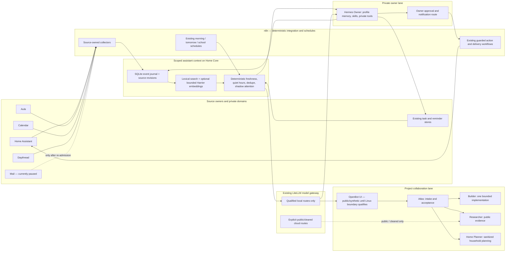

# AI agent ecosystem audit and proposal

**Audit date:** 10 November 2026
**Status:** Read-only investigation and proposal for review. No infrastructure,
workflow, account, model, agent or permission changes were made.

## Executive summary

HomeCompute already has most of the requested building blocks: a private
Hermes owner runtime, scheduled n8n workflows, an authenticated HomeCompute
capability MCP, a scoped assistant-context service, source-owned task and
action controllers, and local inference. Focus the next work on these three
items:

1. Reconcile the current Home Core/Spark revisions and qualify the exact local
   model/runtime route before changing assignments.
2. Shadow-qualify one owner morning briefing through existing n8n schedule
   ownership, then consider replacing one existing delivery after review.
3. Treat MCP gateway work as a dependency owned by the separate Codex project
   **“Investigate a home-core MCP gateway”**, which is evaluating LiteLLM. This
   audit does not duplicate that gateway implementation or research.

The existing OpenBot execution and shared-MCP findings remain recorded in the
current-state assessment as trust-boundary constraints for any later OpenBot
use; they are not an additional implementation track in this focused backlog.

## 1. Current-state assessment

### Live and source evidence

The workstation's selected branch is `dca3795ffce4ad40a2542dff2a1c21f88fa84927`,
22 commits behind its recorded `origin/master` (`67ae681be1a3491d115f996e86b6f84a5c431fa1`).
The worktree already has modified OpenBot files and two untracked audit/handoff
documents. They predate this report and were preserved.

| Area | Verified or documented state | Gap / confidence |
| --- | --- | --- |
| Home Core | Read-only `homecompute status`, `doctor`, and `drift` report revision `67ae681...`, zero failed units and 45 observed containers. n8n 2.46.0, LiteLLM 1.108.4, PostgreSQL 16.15, Mattermost 11.11.4 and the Daythread services were observed running. The assistant-context service and its sync timer were active at the read-only check; the next timer was due at 22:40 CET. | The platform-health one-shot was still `activating` during the check. No source payloads or private memory were inspected. |
| Home Spark / local inference | Spark is reachable at deployed revision `481df8e0225c3530e3c0e244e14e8410d1862af1`, older than desired `67ae681...`; `doctor` found zero failed units. A container named `qwen38-flash-ultrafast` was running. | `homecompute` explicitly cannot safely join live processes to model catalog identities. The catalog still marks `automation-moe` / Flash-Next routes as candidates. Treat the model identity, promotion and route readiness as unverified; do not infer that a running container is the qualified production route. |
| OpenBot | `setup-openbot-guest.sh status` reports the guest online on 0.66.0 at its pinned image digest. The worktree's 10 November read-only DB audit records five existing agent IDs and provider/model assignments: Atlas, Builder, Home Planner and Researcher, plus a separate embedded Hermes ACP pilot. It records `context7` as the only enabled server MCP. | The audited Researcher binding is Codex `gpt-6-luna`, while the manifest says ChatGPT / GPT-6.1-Sol. Keep the existing ID and binding pending an explicit choice. Effective filesystem, provider-account, per-agent MCP and runtime tool reach cannot be inferred from prompts or the database alone. |
| OpenBot access | The same read-only audit records Full access for all five agents; Computer Use and automation allowed for the four regular agents. The Hermes pilot has those two flags disabled. The DB does not expose Local scripts state. | The installed Linux/OpenCode boundary does not enforce Workspace only. Keep all OpenBot work public or synthetic until an isolated execution boundary is verified. The agent prompts and workspace folders are not an enforcement boundary. |
| Hermes | Source and 6 November validation describe a persistent `hermes-personal-v23` OpenShell sandbox, local `automation-moe` at Medium, owner-only Mattermost and authenticated Webapp, HomeCompute MCP, specialist skills, and persistent profile/session state. The 6 November MCP record checked seven read-only tools before and after restart; assistant-context later added ten context tools and passed a synthetic search. | No current guest-side Hermes profile, skill/tool metadata, cron list, session inventory or fresh authenticated client turn was queried for this audit. Do not read raw private session or memory contents for inventory. Current runtime and exact optional Bot Mode/Desktop connection remain to be rechecked. |
| n8n | Connected read-only workflow search found active `Morning weather and reminders · Home` (35 nodes; Europe/Copenhagen; kitchen/presence gated), `Household · tomorrow preparation` (14 nodes; 20:30 Copenhagen), `Aula - Family Briefings` (four schedules), Aula collectors/calendar sync, Home Assistant routes and calendar tools. The morning and tomorrow workflows have durable/duplicate-aware delivery logic. | A read-only execution search reported recent morning polls succeeding, but that does not prove a useful briefing was delivered. The tomorrow workflow was active, while the queried execution search returned no executions; its recent fulfillment is unverified. Do not replace its delivery owner until receipts and recipients are reviewed. |
| Assistant context and memory | Source describes a private SQLite journal/projection, provenance and source revisions, principal/domain/visibility scopes, deletion tombstones, lexical retrieval and optional bounded Harrier embeddings. It has bounded source connectors for Home Assistant, Aula, Calendar and optional Daythread export; attention is shadow-mode. Existing task stores and n8n own operational work. | Current source coverage and freshness were not queried because that would expose private data or cause a source sync. A running service and timer are not evidence that each source is fresh. Automatic context delivery, delegation and improvement publication remain gated. |
| MCP and tool access | Hermes and OpenClaw have existing authenticated, finite HomeCompute MCP routes; n8n also exposes workflow tools. The OpenBot server's current list is `context7`. LiteLLM is already deployed. | There is no configured, qualified universal MCP gateway in source. The existing LiteLLM deployment is not yet configured with MCP upstream servers. OpenClaw role scopes are application policy over shared credentials, not separate cryptographic identities per role. |
| Storage and observability | PostgreSQL is present for the control plane; Valkey is observed as Immich's Redis-compatible store. Assistant context uses scoped SQLite. n8n has execution history; OpenClaw has task/broker state; HomeCompute provides host status and drift. | No general shared Redis queue or cross-product task ledger was identified. Current status is fragmented across n8n, Hermes, OpenBot, OpenClaw and HomeCompute. No single dashboard is justified yet. |
| Email / Daythread | Daythread backend, alignment and diarization containers were observed. Source supports authenticated bounded summary export. | The family mail workflow is paused in live n8n metadata. Daythread's current context coverage, profile classification, deletions and transcript/speaker confidence were not re-read. Do not include mail or Daythread commitments in an actionable briefing until their current source grants and coverage are verified. |

The 10 November OpenBot and MCP findings above are recorded in the pre-existing
worktree notes [OpenBot agent setup](../openbot-agent-setup.md),
[OpenBot/Hermes handoff](../hermes-openbot-team-handoff.md), and
[MCP gateway evaluation](mcp-gateway-evaluation-2026-11-10.md). The worktree
notes themselves are uncommitted and are evidence to review, not applied policy.

### Existing roles and overlap

- **Hermes Owner** already has the private personal-assistant lane, owner
  profile memory, on-demand Day Plan / Follow-through / Home Ops skills,
  bounded HomeCompute MCP and the existing owner task/action lifecycle.
- **OpenBot Atlas** can own OpenBot project intake and acceptance. It should not
  become a second household memory owner. Its agent-to-agent `list_agents` and
  `send_message` capabilities are documented upstream, but their end-to-end
  return path has not been qualified in this installation.
- **Builder** should receive one bounded code task at a time and return the
  artifact and checks. It receives no SSH, production deployment, private
  household or broad GitHub credential.
- **Researcher** is a public-evidence role. Its live cloud binding differs from
  the desired roster; do not silently change that provider/model.
- **Home Planner** should plan from approved extracts and public data. Hermes
  remains the lane for live private household records and Home Assistant.
- **OpenBot's Hermes ACP pilot** is a distinct profile, workspace, history and
  tool context. Preserve it by ID; it is not the Hermes Owner.
- **OpenClaw** is already a separate deployed agent/tool and task system with
  role files, native delegation and worker/broker paths. Reuse qualified
  components where they already own a lifecycle; do not build a second generic
  coordinator on top of it.
- **n8n** owns deterministic schedules, event intake, retries and integration
  credentials. Models may classify or draft within fixed bounds, but do not
  replace its workflow authority.

## 2. Target architecture

The important trust boundaries sit below model prompts: separate source
credentials, event principal/domain/visibility, per-client tool keys, network
allow-lists and existing action controllers. Original records stay in their
owning services. Private Hermes memory is working context; the assistant-context
journal is the scoped cross-source ledger; task stores and n8n execution records
remain authoritative for commitments and automation receipts.

## 3. Agent configuration proposal

Preserve all current OpenBot server IDs, conversation history, profiles and
provider bindings. These are proposed responsibilities and target permissions,
not an instruction to apply them now.

| Agent | Responsibility and target model | Tool / memory boundary | Delegation |
| --- | --- | --- | --- |
| Hermes Owner | Personal context, planning and follow-through. Retain local `automation-moe` at Medium pending current route verification. | Owner-only Hermes profile memory and current finite HomeCompute/context tools; Home Assistant writes remain proposal/approval controlled. No n8n administrator grant. | Personal task coordinator. Delegate only a scoped, one-hop task when the destination, data class and return path are qualified. |
| Atlas | OpenBot project intake, task framing and acceptance. Retain existing local `automation-moe` / Medium binding pending route verification. | No household source credentials or owner MCP. Keep Computer Use, automation and state-changing access disabled until individually reviewed; Linux OpenCode workspace access remains unqualified. | Assign Builder one bounded implementation; ask Researcher only a public or cleared question. No recursive delegation. |
| Builder | Code, review, test and debug one assigned project task. Existing local `automation-moe` / Medium. | Task-specific repo/worktree only after its isolation is effective; no production SSH, deployment, personal data or broad GitHub credentials. | None by default. Return patch/artifact, checks and unresolved issues to Atlas. |
| Researcher | External research and comparisons. Existing live binding is Codex / `gpt-6-luna` / High; desired roster says ChatGPT / GPT-6.1-Sol / High. Preserve until the owner resolves the discrepancy. | Public web and public/cleared prompt data only. Cite primary sources and distinguish fact from inference. | No delegation by default. Return evidence to task owner. |
| Home Planner | Household planning, maintenance and energy recommendations from approved extracts/public information. Existing local `automation-moe` / Medium. | No live HA control, private calendar/Aula credentials, purchases or contacts. Route live household questions to Hermes Owner. | May prepare a sanitized technical task for Atlas; no direct implementation. |
| Existing OpenBot Hermes ACP pilot | Keep as an optional local-model tool/ACP pilot, not the personal assistant. Existing pilot uses the same local alias with `xhigh` in the recorded manifest. | Public or synthetic workspace and its own existing profile. No owner memory, household tools, private credentials or automatic actions. | No production delegation. |

Do not claim Qwen3.8 Flash-Next is the qualified default solely because a
container is running. Resolve the Spark revision drift and catalog-to-runtime
identity first. Use the local route by default only when the exact deployment,
tool behavior, context size and latency are qualified. Use cloud Researcher for
public research when it adds value; do not introduce silent cloud fallback for
private inputs. Avoid adding agents for individual repositories.

For all specialist work, use one task owner and one hop. Each result should
return `task_id`, status, concise result, source/evidence references, actions
actually completed, artifacts, failures/uncertainty and recommended next step.
Timeout means unknown completion until the owning controller reconciles it; do
not retry a possibly delivered action without its idempotency receipt.

## 4. Memory and MCP design

### Memory: reuse, do not replace

| Required memory class | Existing owner / reuse |
| --- | --- |
| Long-term preferences and stable personal facts | Hermes profile memory for bounded working continuity plus the assistant-context reviewed memory projection. Owner-only until an explicit shared projection is approved. |
| Project and episodic history | Original project repositories, n8n receipts, Daythread source records and the assistant-context source-linked journal. Keep source ID, version/revision, timestamp, owner/domain/visibility and deletion state. |
| Operational tasks, approvals and deadlines | Existing owner task/reminder controller, n8n execution/claim tables and Home Assistant approval/action flow. Do not make semantic memory the task database. |

The existing service already documents correction/deletion, deduplication,
source coverage, tombstones, lexical fallback and optional Harrier retrieval.
Keep embeddings an index over authorized excerpts, never a new authority. Do not
copy all conversations into permanent memory. Do not create a PostgreSQL/pgvector
service unless measured concurrency or recovery needs exceed this design. The
existing control-plane PostgreSQL and Immich Valkey do not become shared memory
merely by being present.

### MCP and tools

First candidate: qualify the **already deployed LiteLLM 1.108.4** MCP gateway
against the required client and version set. Current upstream documentation
describes HTTP/Streamable HTTP, named routes and key/team/organization access
controls ([LiteLLM MCP overview](https://docs.litellm.ai/docs/mcp/),
[configuration reference](https://docs.litellm.ai/docs/mcp_config_reference)).
The current HomeCompute source has no MCP upstream declarations, so this is a
candidate only. Test scope on the installed version and confirm that source can
reproduce server/tool declarations, client identity, revocation and sanitized
audit events. Use separate per-consumer credentials and exact tool grants.

If LiteLLM cannot meet those controls without over-coupling model and tool
administration, compare MCPHub as the already researched fallback. Do not add
both gateways. For either option, begin with synthetic/read-only HTTP upstreams,
no Docker socket, no arbitrary stdio process launching, private ingress and
negative authorization tests. Keep OpenBot excluded while the server shares
MCP connections across agents. Keep raw Home Assistant write actions behind the
existing controller. Treat a key or group as authentication, not as business
approval.

## 5. Proactive briefing and follow-up

The initial end-to-end case should be a **single owner morning briefing**,
qualified by reusing existing n8n schedules and the current context routine
contracts. Do not add a competing schedule. Inputs are the selected owner
calendar, bounded Aula updates/schedule, open owner tasks and reminders, current
Daythread summaries only after its profile/source coverage is verified, and
selected Home Assistant alerts/observations. Mail is excluded while its intake
workflow is paused. Preserve separate critical Home Assistant notifications.

1. An existing n8n schedule or source event creates an idempotent occurrence.
2. Existing source-owning collectors admit bounded, versioned snapshots; failed
   or partial reads update coverage metadata and never turn into “nothing due.”
3. Deterministic code filters duplicates, stale items, quiet hours and the
   notification budget, then retrieves authorized records for the owner scope.
4. Local inference may classify relevance and draft a concise source-linked
   summary. Model output cannot select credentials, scope, recipients, action
   targets or urgency. If inference fails, keep the deterministic summary.
5. Hermes reviews/answers interactively. The owner receives one useful digest
   through the existing delivery path; uncertain Daythread attribution is
   labelled as a candidate, not an accepted commitment.
6. Confirmed reminders go through the existing durable task controller. Device,
   calendar, messaging or other consequential writes continue through the
   owning action/approval workflow.
7. Record only task/run IDs, state, source revisions/coverage, timing, model and
   delivery receipt metadata. Suppress duplicate occurrences and do not retry an
   ambiguous send without reconciling its delivery receipt.

Start with a shadow comparison against the current morning/Aula/tomorrow
outputs. Acceptance requires complete coverage labels, source links, no private
scope crossing, duplicate suppression, useful owner feedback, stable delivery
receipts and deterministic fallback. Only after approval and a fresh backup may
one existing owner notification node be replaced. Retain a direct rollback to
its preimage; keep school and critical HA notices independent.

## 6. Prioritized implementation backlog

Complexity: **S** = a few focused changes/checks; **M** = one bounded component
or workflow; **L** = cross-service lifecycle or new trust boundary.

| Priority / phase | Task, prerequisites and complexity | Main risk | Measurable acceptance | Rollback |
| --- | --- | --- | --- | --- |
| P0 / 1 Audit | Reconcile local branch/worktree, desired origin revision, current host/guest revisions, source-rendered configs and OpenBot backup receipt. Read-only first. **S** | Stale source or backup evidence misleads a later apply. | Exact current revisions, image IDs, backup/restore receipts, and every unresolved divergence listed without secrets. | No state change; preserve all receipts and return to the prior reviewed revision for any later implementation. |
| P0 / 1 Audit | Obtain privacy-safe metadata for Hermes profile/version, enabled skills/tool names, current cron metadata, owner Webapp/Mattermost health and assistant-context source coverage. Do not read raw sessions or memory. **S–M** | Metadata query may expose private content if unbounded. | Allow-listed metadata only; each source marked fresh/partial/failed with timestamp; current Hermes client path verified. | No mutation; stop the query if it requires raw content or new listeners. |
| P0 / 1 Audit | Reconcile Spark drift and identify exact Qwen/embedding runtime-to-catalog tuple before model routing changes. **M** | Candidate model or mismatched runtime promoted as production. | Immutable process/image/model identity, route, qualification and rollback tuple match reviewed source. | Retain current images and dedicated rollback lifecycle; no automatic model promotion. |
| Dependency / 2 Foundations | Consume the reviewed outcome of Codex project **“Investigate a home-core MCP gateway”** (LiteLLM). Keep gateway design, implementation and qualification in that project; do not create a parallel gateway task here. | Findings may not qualify all client identities, scopes or tool boundaries needed by this ecosystem. | Before onboarding clients, its result documents the installed version, source-managed upstreams, per-client permissions, negative authorization tests, sanitized audit data, key revocation, recovery and rollback. | Keep existing direct integrations; defer new gateway clients until the owning project supplies a qualified result. |
| P1 / 2 Foundations | Clarify Atlas/Builder/Researcher/Home Planner contracts and Agent-to-agent return path, preserving OpenBot IDs and existing bindings. **S–M** | Prompt edits mistaken for technical enforcement; cloud disclosure. | One-hop synthetic handoff returns task ID, artifact/evidence and completion state; private/network/tool denial is enforced outside prompts. | Restore exact prior role text/settings on the same IDs. |
| P1 / 2 Foundations | Define a shared task receipt adapter over existing task and workflow state; do not create a second queue. **M** | Duplicate task ownership or retry causing repeated actions. | Task ID, owner, lifecycle, idempotency key, approval and final/unknown state are queryable across the chosen clients. | Remove the read adapter; owning systems remain authoritative. |
| P2 / 3 Proactive | Shadow-assemble the combined morning briefing through the existing context routine and n8n owner schedule. No external delivery. **M** | Missing coverage appears as an empty day; duplicated notifications. | Synthetic and shadow cases show freshness/partial labels, source links, no duplicate occurrence and deterministic fallback. | Disable shadow projection; existing briefing workflows remain unchanged. |
| P2 / 3 Proactive | After review, migrate one owner delivery node and enable only its bounded standing grant; keep school/critical HA paths. **M** | Wrong recipient, duplicate, uncertain send or unapproved private source. | Reconciled caller-bound grant, one delivery per occurrence, durable receipt, quiet-hour/limit enforcement and owner feedback. | Revert the exact workflow node and disable the grant; preserve old workflow and data state. |
| P3 / 4 Shared intelligence | Verify scoped memory correction/deletion and optional retrieval across owner, household-shared and project domains; add only missing projections. **M** | Derived data leakage or incomplete deletion in indexes/backups. | Cross-principal denial, correction and deletion tombstone tests pass; source references and revisions remain inspectable. | Disable semantic retrieval and use lexical/source-native paths; restore from verified snapshot only under the deletion ledger. |
| P3 / 4 Improvement | Extend propose→replay→reviewed Git lifecycle only to measured improvement classes. Keep security, permission, deployment and model promotion outside autonomous apply. **M** | Self-modification broadens its own authority or regresses behavior. | Repeated failure/feedback creates a versioned candidate; held-out replay, canary, independent review and rollback evidence pass. | Revert reviewed source change and policy receipt; no model can merge or deploy itself. |
| P4 / 5 Optimization | Measure notification usefulness, completion, latency, local/cloud token cost, retry rates and source freshness; remove a redundant path only after a stable pilot. **S–M** | Consolidation removes a working family alert or creates hidden latency. | Agreed thresholds met for a review period; no critical source coverage or alert regression. | Restore the previous scheduler/notification path from its source and preserved receipts. |
| Optional | Test Hermes Desktop Bot Mode as a client to the existing remote owner profile, with one harmless synthetic turn. **S** | A second interface splits session history or starts another scheduler/backend. | Authenticated HTTP and WebSocket reach the existing profile, memory/tool scope is correct, and no duplicate gateway or schedule starts. | Remove only the Desktop connection; keep current Hermes Webapp/Mattermost clients. |

## 7. Recommendation classification

| Class | Recommendations |
| --- | --- |
| **Essential** | Recheck Spark drift and model qualification; verify current source coverage and backup receipts before any data/config change; preserve controller approval for consequential actions. OpenBot access findings remain constraints in this audit, outside the four focused work items. |
| **Recommended** | Reuse the assistant-context service and current n8n schedules; qualify a combined owner briefing in shadow mode; consume the LiteLLM gateway decision from the separate Codex project; define one-hop structured task receipts and privacy-safe status queries. |
| **Optional** | A small Hermes Desktop Bot Mode trial as a remote client to the existing owner profile; further OpenBot collaboration only after its return path and isolation are tested. Hermes Bot Mode offers profile-based bots, persistent bot chats and routines in Desktop, but this does not establish that the current installation has a qualified Desktop connection. See [official Bot Mode](https://hermes-agent.nousresearch.com/docs/user-guide/bot-mode) and [remote gateway connections](https://hermes-agent.nousresearch.com/docs/user-guide/multi-connection-desktop). |
| **Not worth implementing now** | A new PostgreSQL/pgvector memory service, a second daily scheduler, a general event bus, a new large dashboard, a new agent per project, broad OpenBot MCP access, direct LLM-to-Home-Assistant writes, or parallel MCP gateways. |

## 8. Audit limits and handoff

This is an architecture proposal, not implementation approval. The workstation
branch is behind `origin/master` and already contains uncommitted user work.
The exact current Hermes metadata and Daythread/source coverage remain
unverified. The observed Home Core state is current only for the read-only
checks above; Spark remains at an older revision. No live histories, credentials,
recordings, raw messages or personal memory were read. No tests, workflow
execution, agent turn, permission change, deployment or service mutation was
performed.

Before implementation, review this proposal alongside the existing uncommitted
OpenBot/MCP handoff notes. If approved later, implement from a reviewed source
revision with fresh backups and each workload's guarded lifecycle. Approval of
this plan would not itself authorize production changes, cloud disclosure or
new data admission.

Relevant source: [HomeCompute operations](../homecompute-operations.md),
[OpenBot operations](../../deploy/openbot/README.md),
[Hermes runbook](../../deploy/hermes/README.md),
[assistant-context runbook](../../deploy/assistant-context/README.md),
[n8n workflows](../../automations/README.md),
[ADR-015 data domains](../adr/015-personal-data-domains-and-memory.md),
[ADR-029 proactive context](../adr/029-proactive-assistant-context.md),
[ADR-030 OpenBot deployment](../adr/030-openbot-team-server.md), and
[proactive assistant plan](../proactive-personal-assistant-plan.md).
